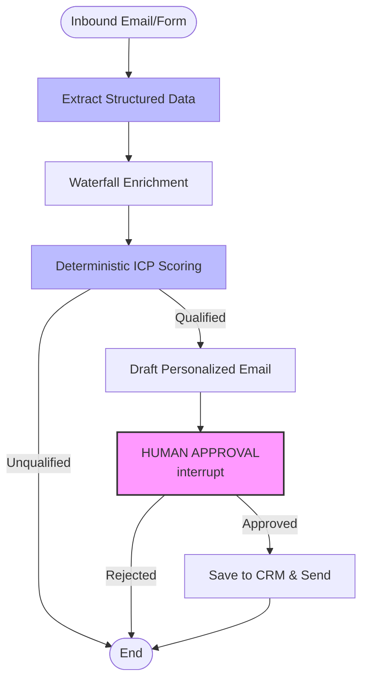
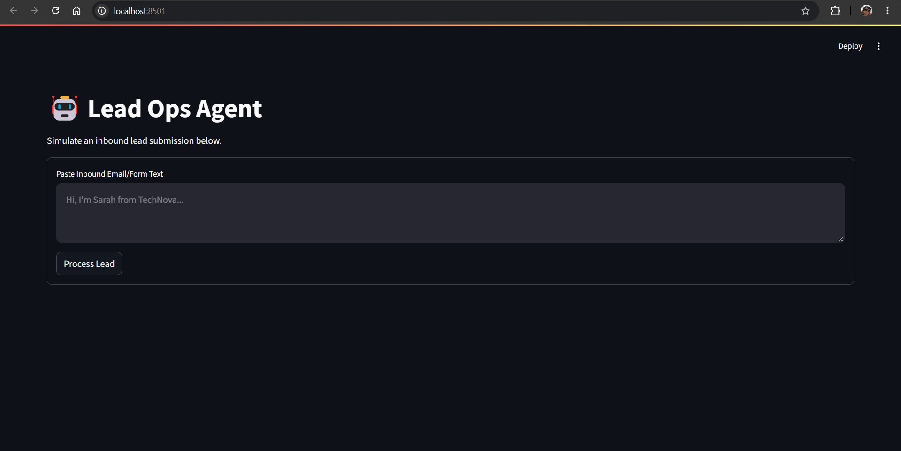
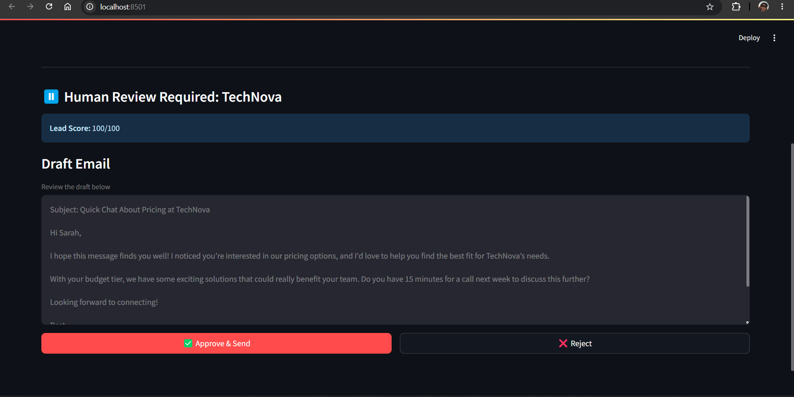
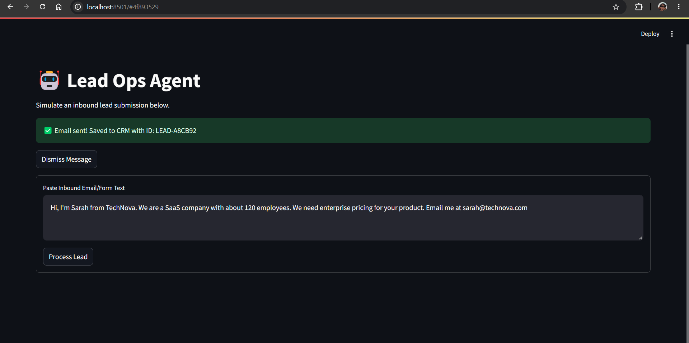
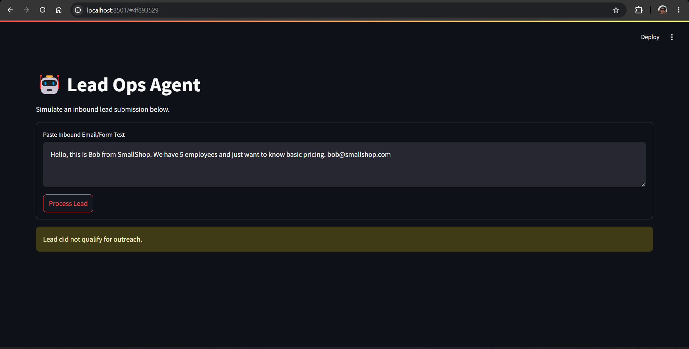
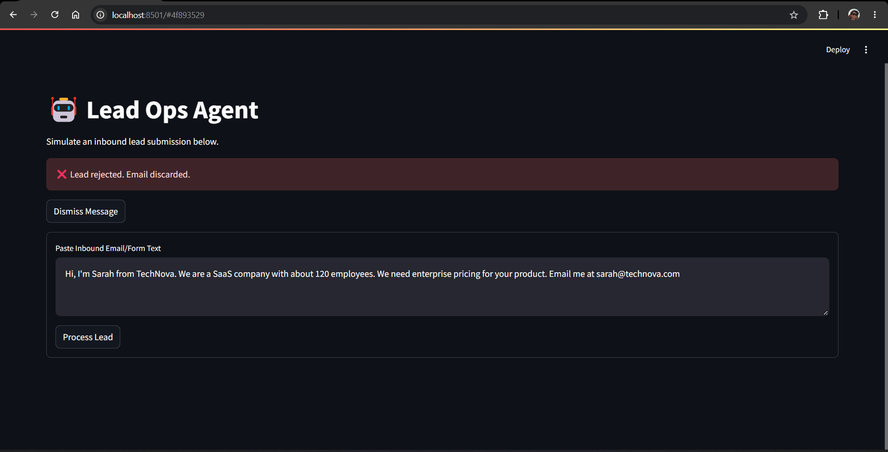
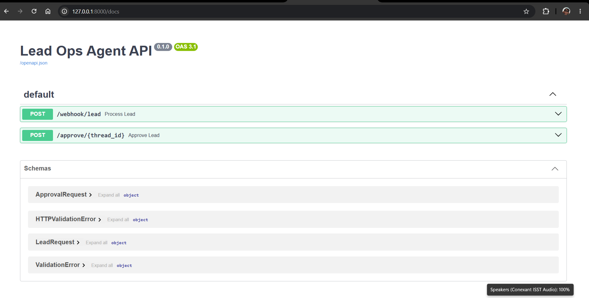

# Lead Ops Agent

> An AI business automation agent for B2B sales teams. It extracts lead data from inbound messages, enriches it with company insights, scores it against an Ideal Customer Profile (ICP), and drafts personalized follow-up emails — pausing for human approval before taking action.

[](https://www.python.org/downloads/release/python-3120/)
[](https://github.com/langchain-ai/langgraph)
[](https://fastapi.tiangolo.com/)
[](https://streamlit.io/)
[](https://docs.docker.com/compose/)

## The Problem

Sales teams waste hours manually reading inbound emails, Googling companies, scoring leads, updating the CRM, and drafting follow-ups. 

Most "AI chatbots" just answer questions. This project is a **workflow automation engine** that actually does the work, while keeping a human in the loop for safety.

## Architecture



## Screenshots

### 1. Processing an Inbound Lead

The sales rep pastes a raw inbound email or form submission into the dashboard.

### 2. Human-in-the-Loop Approval

The agent extracts the data, calculates a deterministic ICP score of `100/100`, and drafts a personalized email. The graph then **pauses indefinitely** (`interrupt()`) until the human reviews the draft.

### 3. Successful CRM Sync

Once the human clicks "Approve," the graph resumes, saves the record to the mock CRM, and returns a unique `LEAD-XXXX` ID.

### 4. Guardrails in Action (Rejecting a Lead)

If a lead does not meet the ICP threshold (e.g., a 5-person company), the agent short-circuits the graph. It never drafts an email or bothers the sales team.

### 5. Human Rejection

If the human clicks "Reject," the email is discarded, and the agent stops safely.

### 6. API Documentation

The FastAPI backend automatically generates interactive Swagger UI docs at `/docs` for the `/webhook/lead` and `/approve/{thread_id}` endpoints.

## Key Engineering Decisions

### 1. The Human-in-the-Loop (HITL) Pattern
Using LangGraph's `interrupt()`, the graph freezes completely before sending an email. The state is serialized, and the API returns the draft to the UI. The graph only resumes when the user clicks "Approve" or "Reject" via a `Command(resume=...)`. This makes it safe for production.

### 2. LLM for Extraction, Python for Math
LLMs are notoriously bad at calculating scores (e.g., forgetting to add +30 for industry). The LLM is only used to extract unstructured facts (name, intent). The actual scoring against the ICP is pure, deterministic Python, making it 100% reliable, testable, and explainable.

### 3. Waterfall Enrichment
If the user explicitly mentions their company size in the text ("we have 120 employees"), we trust the text. If they omit it, we fall back to a mock enrichment API. The code merges the two, prioritizing the text. This prevents hallucinations and ensures maximum data coverage.

## Features

- ✅ **Structured Extraction** — Pydantic-enforced `Literal` types prevent the LLM from hallucinating invalid intents or budgets.
- ✅ **Waterfall Enrichment** — Merges user-provided text data with mock 3rd-party API data.
- ✅ **Deterministic Scoring** — Pure Python logic scores the lead against the ICP rules (0-100).
- ✅ **Human-in-the-Loop (HITL)** — Graph pauses infinitely until a human clicks "Approve" or "Reject".
- ✅ **FastAPI Backend** — REST endpoints for webhooks and resuming the graph.
- ✅ **Streamlit Dashboard** — Interactive UI to simulate inbound leads and review drafted emails.
- ✅ **Dockerized** — Fully containerized with Docker Compose.

## Stack

| Layer | Tech |
|-------|------|
| Orchestration | LangGraph (`StateGraph`, `interrupt`, `MemorySaver`) |
| LLM | OpenAI GPT-4o-mini |
| Backend | FastAPI + Uvicorn |
| UI | Streamlit (Approval Dashboard) |
| Containerization | Docker + Docker Compose |
| Runtime | Python 3.12 |

## Quickstart

### Run with Docker (Recommended)

```bash
git clone https://github.com/jaskaranjjk97/Lead-Ops-Agent.git
cd Lead-Ops-Agent
cp .env.example .env
# Edit .env with your OpenAI key

docker compose up --build
```
Open **http://localhost:8501** to access the Lead Ops Dashboard.

### Run Locally

```bash
python -m venv .venv
source .venv/bin/activate  # Windows: .venv\Scripts\activate
pip install -r requirements.txt
cp .env.example .env       # add your OpenAI key

# Start the API
uvicorn app.main:app --reload --port 8000

# In a second terminal: start the UI
streamlit run ui/streamlit_app.py
```

## Environment Variables

```env
OPENAI_API_KEY=sk-...
OPENAI_MODEL=gpt-4o-mini
```

## Example Workflow

1. **Inbound Text:** *"Hi, I'm Sarah from TechNova. We are a SaaS company with about 120 employees. We need enterprise pricing for your product. Email me at sarah@technova.com"*
2. **Agent Extraction:** Extracts `TechNova`, `SaaS`, `120 employees`, `high budget`, `pricing intent`.
3. **Agent Scoring:** Python code calculates a score of `100/100` (Qualified).
4. **Graph Pauses:** The UI displays the drafted email and waits for approval.
5. **Human Action:** User clicks "Approve".
6. **Graph Resumes:** Saves the lead to `data/crm.json` and gives a success message with the CRM ID.

## Project Structure

```
lead-ops-agent/
├── app/
│   ├── config.py                # env + settings
│   ├── llm.py                   # ChatOpenAI factory
│   ├── state.py                 # LeadState TypedDict
│   ├── graph.py                 # StateGraph wiring with interrupts
│   ├── main.py                  # FastAPI webhook & resume endpoints
│   ├── tools/
│   │   ├── enrichment.py        # Mock Clearbit API
│   │   └── crm.py               # Mock HubSpot CRM
│   └── nodes/
│       ├── extract.py           # Structured data extraction
│       ├── enrich.py            # Waterfall enrichment logic
│       ├── score.py             # Deterministic Python scoring
│       ├── draft.py             # Email drafting
│       ├── approval.py          # Human-in-the-loop (interrupt)
│       └── finalize.py          # CRM sync
├── data/
│   ├── crm.json                 # Mock CRM database
│   └── icp.json                 # Ideal Customer Profile rules
├── tests/
│   ├── test_setup.py
│   ├── test_thinking.py         # Tests Extract/Enrich/Score
│   ├── test_hitl.py             # Tests interrupt/resume CLI flow
│   └── test_score.py            # Tests scoring determinism
├── ui/
│   └── streamlit_app.py         # Approval Dashboard
├── Dockerfile
├── Dockerfile.ui
├── docker-compose.yml
├── requirements.txt
└── README.md
```

## Limitations

- **In-memory checkpointer** — `MemorySaver` loses state on server restart. Production would use `SqliteSaver` or `PostgresSaver`.
- **Mock APIs** — Enrichment and CRM actions use local JSON files. The architecture is designed so swapping to real HubSpot/Clearbit APIs requires changing only the `tools/` directory.
- **No authentication** — The API and UI have no auth layer. Production would require JWT tokens or OAuth.

## License

MIT -see [LICENSE](./LICENSE).